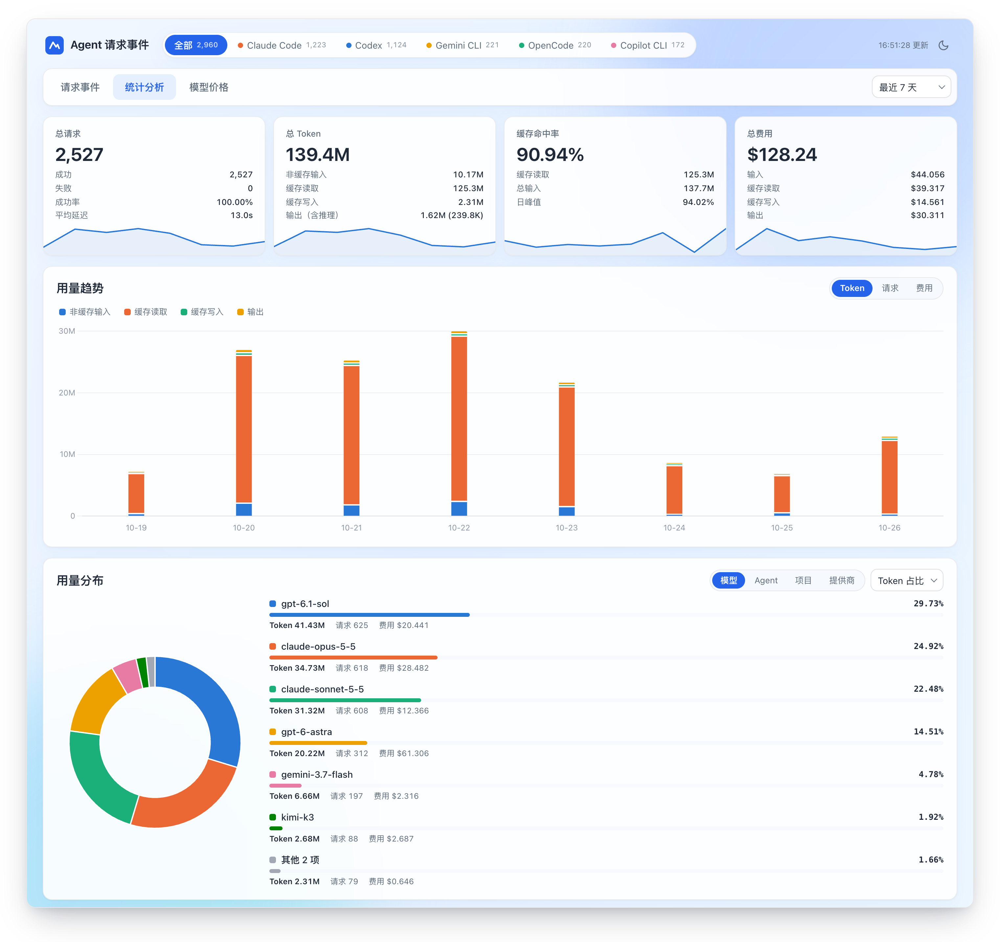

# agent-events

在浏览器中查看本机 AI 编程助手的每一次模型请求：Token 用量、费用、速度和失败原因。



支持 Claude Code、Codex、OpenCode、Kilo Code、Antigravity、Gemini CLI、Qwen Code、GitHub Copilot CLI、Amp、Codebuff、Factory Droid、Goose、Grok Build、Hermes、Kimi、OpenClaw、Pi 和 ZCode。只读取本机日志，请求数据不会上传。

## 安装

从 [Releases](https://github.com/haowang02/agent-events/releases) 下载对应平台的压缩包并解压，或者：

```sh
go install github.com/haowang02/agent-events/cmd/agent-events@latest
```

macOS 首次运行下载的二进制被拦截时，执行 `xattr -d com.apple.quarantine agent-events`。

## 使用

```sh
agent-events
```

启动后自动在浏览器打开 http://127.0.0.1:8790 ，有新请求时页面自动刷新。

| 参数 | 说明 |
| --- | --- |
| `-addr` | 监听地址，默认 `127.0.0.1:8790`；端口被占用时自动改用空闲端口 |
| `-data` | 数据目录，默认 `~/.local/share/agent-events` |
| `-no-open` | 不自动打开浏览器 |
| `-rebuild` | 清空已采集的请求并重新读取全部日志，保留自定义价格 |
| `-version` | 显示版本 |

费用按 [models.dev](https://models.dev/) 的参考价计算，也可以在「模型价格」页为模型设置自定义价格。

## 文档

- [数据来源](docs/data-sources.md)：各 Agent 的日志位置、环境变量和统计口径
- [价格](docs/pricing.md)：价格来源、内置别名和计价规则
- [开发与发布](docs/development.md)
